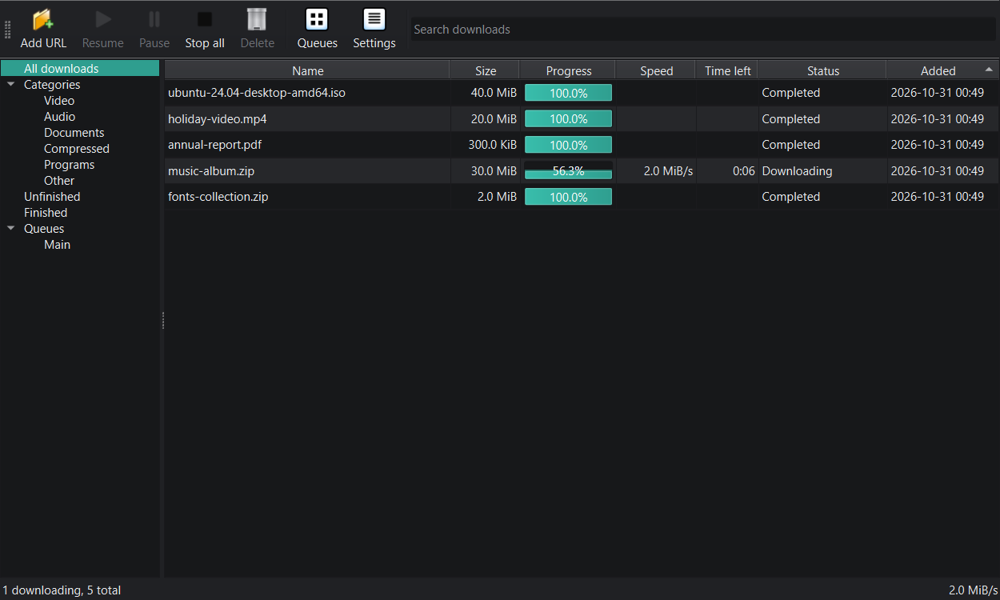
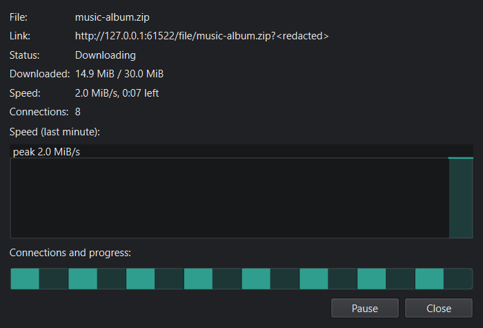
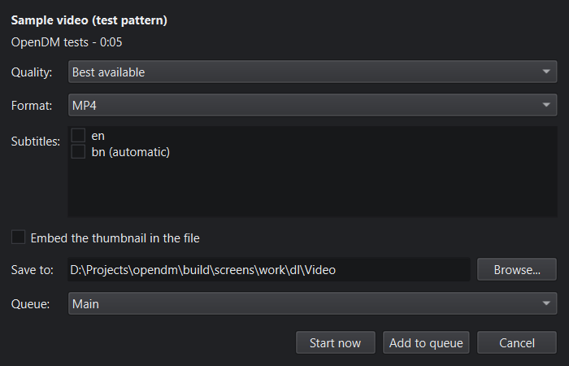

# OpenDM

A free, open-source download manager for Windows. No ads, no account, no subscription and
no telemetry.



**[Download the latest release](https://github.com/Indrajit147/OpenDM/releases)** ·
[Install guide](docs/INSTALL.md) · [User guide](docs/USER_GUIDE.md) · [FAQ](docs/FAQ.md) ·
[Changelog](CHANGELOG.md)

## Features

- **Fast, reliable downloads:** up to 32 connections per file, pause and resume, automatic
  retries, and recovery after a crash or a lost connection. Expired links can be refreshed
  without starting over. Optional SHA-256/SHA-1/MD5 check.
- **Organised:** categories with their own folders, queues with start/stop times and
  "sleep or shut down when done", speed limits, search, light and dark themes, tray icon.
- **Video and audio** from YouTube and many other sites through
  [yt-dlp](https://github.com/yt-dlp/yt-dlp) and FFmpeg: quality picker, MP3/M4A, subtitles,
  playlists. The tools are downloaded only with your consent and checked against their
  published checksums. DRM-protected content is not supported.
- **Chrome and Edge extension:** browser downloads go to OpenDM (logins included), right-click
  "Download with OpenDM", "Download all links", and a button on videos.
- **Command line:** `opendm-cli get <link>`, through the running app or on its own.
- **Your choice of updates:** an optional update check shows release notes; installers are
  checked against their published SHA-256 and run only when you click Install.
- Per-user **installer** (no admin rights, any drive) and a **portable** ZIP.

| Details: speed graph and connection map | Video quality picker |
| --- | --- |
|  |  |

## Install

1. Download `OpenDM-<version>-setup.exe` (or the portable ZIP) from the
   [Releases page](https://github.com/Indrajit147/OpenDM/releases).
2. Run it from File Explorer. The builds are not code-signed yet, so Windows SmartScreen may
   warn: choose *More info -> Run anyway* only for a file from this repository's releases
   (you can check it against `SHA256SUMS.txt`, see the [install guide](docs/INSTALL.md)).
3. For the browser: **Edge** - install
   [OpenDM Integration from Edge Add-ons](https://microsoftedge.microsoft.com/addons/detail/opendm-integration/bionffckkflcblecfgnclbndjflemgld).
   **Chrome** - load the `extension` folder shown in OpenDM -> *Settings -> Browser* as an
   unpacked extension ([install guide](docs/INSTALL.md#browser-extension-chrome-and-edge)).

Windows 10 (1809+) or 11, 64-bit.

## Privacy and security

OpenDM only connects to the internet for your downloads, for tools you agree to download and
for the update check if you turn it on. Cookies and logins from the browser are stored
encrypted and only sent to the site they belong to. See [PRIVACY.md](docs/PRIVACY.md) and
[SECURITY.md](docs/SECURITY.md) (including how to report a security problem privately).

## Code signing policy

Releases are built from tagged source by the public
[release workflow](.github/workflows/release.yml) on GitHub-hosted runners. They are not
code-signed yet. The [SignPath Foundation](https://signpath.org) (free code signing for
open-source software) asked OpenDM to reapply once the project is more widely known; the
release workflow is ready for it ([CODE_SIGNING.md](docs/CODE_SIGNING.md)). Once accepted,
releases are signed through [SignPath.io](https://signpath.io) with a certificate issued to
SignPath Foundation, and every signing request is approved by hand.

- Author, reviewer and approver: [Indrajit Gupta](https://github.com/Indrajit147)
- Privacy policy: [PRIVACY.md](docs/PRIVACY.md). OpenDM sends nothing to its developers;
  the update check is off until you turn it on.

## Disclaimer

You are responsible for making sure you have the right to download any content you use
OpenDM for. OpenDM does not support DRM-protected or encrypted content and does not bypass
paywalls, logins or CAPTCHAs.

OpenDM is an independent project and is not affiliated with any commercial download manager.

## Contributing

Bug reports and pull requests are welcome; see [CONTRIBUTING.md](CONTRIBUTING.md) and the
[Code of Conduct](CODE_OF_CONDUCT.md). Quick start (CMD):

```
py -3.12 -m venv .venv
.venv\Scripts\python.exe -m pip install -e .[dev]
.venv\Scripts\python.exe -m pytest -q
```

Build the programs, portable ZIP and installer with `scripts\build.cmd` (needs Inno Setup 6).
How the project is built and tested: [docs/TESTING.md](docs/TESTING.md),
[docs/DECISIONS.md](docs/DECISIONS.md), [PROGRESS.md](PROGRESS.md).

## License

Copyright (C) 2026 Indrajit Gupta.
OpenDM is free software, licensed under the [GNU GPL v3.0 or later](LICENSE).
Third-party components are listed in [THIRD_PARTY_LICENSES.md](THIRD_PARTY_LICENSES.md).
